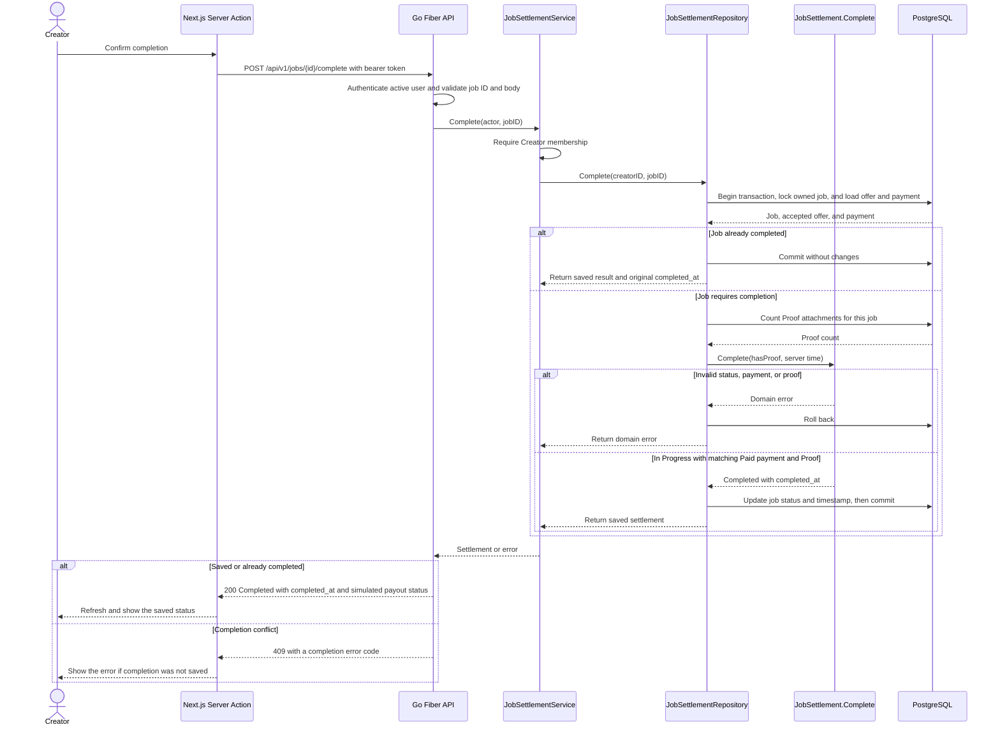

# Job completion API design

The owning Creator confirms delivery with `POST /api/v1/jobs/{id}/complete`. The API requires an `In Progress` job with an accepted offer, a matching `Paid` payment, and a Proof attachment. The recorded payment and payout are simulated. See the [OpenAPI contract](openapi.yaml) and the [job workflow guide](job-workflow.md) for setup and example requests.

## UML sequence diagram



Authentication and authorization happen before completion checks. Invalid authentication returns `401`, insufficient access returns `403`, and a missing job returns `404`. An invalid ID or unsupported request body returns `422 validation_error`. The PostgreSQL completion trigger also checks that a status update to `Completed` has a Proof attachment and an `accepted_offer_id`.

## Demo the unit test

From the backend root, run the seven existing cases for `JobSettlement.Complete`. No database is required.

```powershell
New-Item -ItemType Directory -Force coverage | Out-Null
go test -count=1 -v -run '^TestJobSettlementComplete$' '-coverprofile=coverage/job-completion.out' ./internal/core/domain
go tool cover '-func=coverage/job-completion.out'
```

Find the row for `Complete` in `internal/core/domain/job_settlement.go`. It should show **100.0% statement coverage** for that function. The `total` row measures the entire domain package for this test run.

The cases cover success, an accepted job that has not started, a job already marked complete, no payment, a pending payment, a different payment amount, and missing Proof. The unit test checks that validation failures leave the domain state intact. The repository handles repeated API requests by returning the saved record before calling the domain method again.

## Demo the API in Swagger

1. Open [Swagger UI](http://localhost:8081/docs/swagger) on the local backend. Use a test database and follow the [job workflow guide](job-workflow.md) through recording the exact accepted price as `Paid`. Leave the job `In Progress` with no Proof.
2. Authorize as the Creator and send `POST /api/v1/jobs/{id}/complete` with the job ID and no body. Expect `409 completion_proof_required`.
3. Authorize as the hired Marketer and submit the example Proof with `POST /api/v1/jobs/{id}/proofs`.
4. Switch back to the Creator and complete the job. Expect `200`, `data.job_status: Completed`, and `data.completed_at`. Repeat the request and confirm the timestamp stays the same.

`TestSwaggerWorkflow` runs the same completion checks against PostgreSQL using the served OpenAPI examples. See [the automated workflow setup](job-workflow.md#run-the-automated-workflow).
