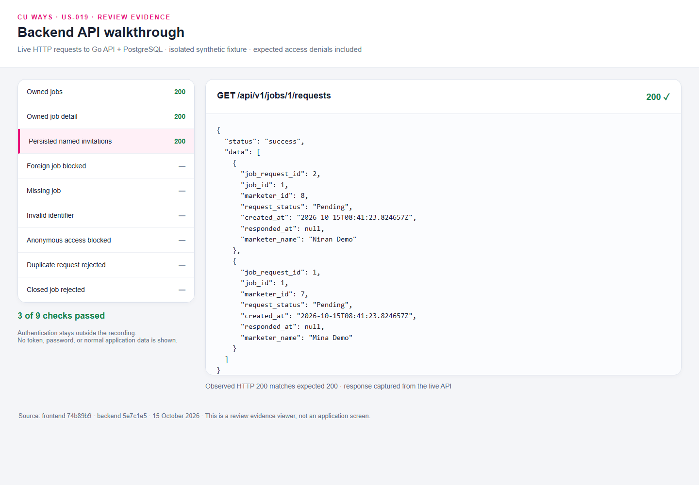
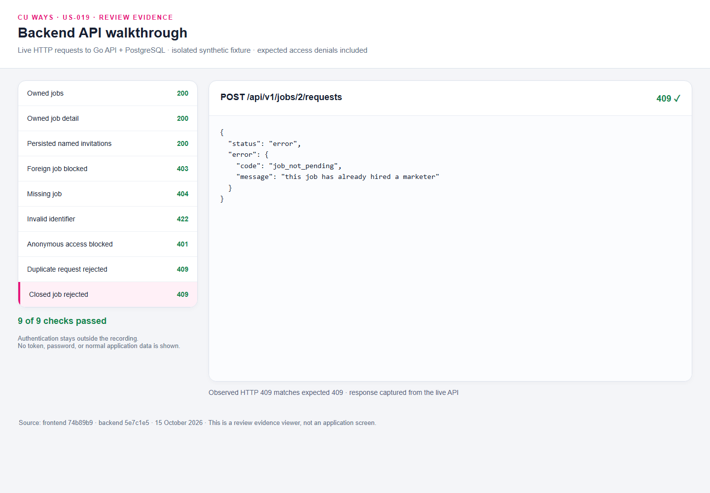

# US-019 live API walkthrough

[Watch or download the API recording](./backend-api.mp4).

The recording shows a review evidence viewer issuing actual HTTP requests to
the Go API backed by an owned disposable PostgreSQL database. It is a developer
evidence viewer, not Swagger or an application screen. Only synthetic fixtures
are shown; credentials and authorization headers remain outside the recording.
Playwright uses 500 ms pacing, with reading pauses for each response.

## Checks

| Request                                           | Expected result                                                   |
| ------------------------------------------------- | ----------------------------------------------------------------- |
| `GET /api/v1/me/jobs`                             | 200, only the signed-in Creator's jobs                            |
| `GET /api/v1/jobs/{owned_id}`                     | 200, owned job and linked surveys                                 |
| `GET /api/v1/jobs/{owned_id}/requests`            | 200, two named Pending invitations persisted by the real frontend |
| `GET /api/v1/jobs/{foreign_id}`                   | 403                                                               |
| `GET /api/v1/jobs/2147483647`                     | 404                                                               |
| `GET /api/v1/jobs/not-a-number`                   | 422                                                               |
| Anonymous `GET /api/v1/me/jobs`                   | 401                                                               |
| Duplicate `POST /api/v1/jobs/{owned_id}/requests` | 409 `job_conflict`                                                |
| `POST /api/v1/jobs/{non_pending_id}/requests`     | 409 `job_not_pending`                                             |

See [captured response data](./api-results.json) for observed status codes,
synthetic response bodies, and request IDs. The associated frontend recording
demonstrates the two successful invitation writes; the rejected POST requests
in this recording do not create further invitations.

[Independent SQL readback](./persistence-readback.json) confirms that exactly two
Pending invitations remain after the rejected POST probes, with a clean version-9
schema.

### Observed wording issue

The non-Pending fixture is **Cancelled**. Its response correctly returns HTTP
409 with `job_not_pending`, but the existing backend message says that the job
has already hired a marketer. This capture does not establish a hire; it exposes
an existing wording issue. The actual response is preserved in the recording
and JSON. A status-neutral message is a separate product follow-up; this media
commit does not change backend behavior.

## Fixture and provenance

Captured on 15 October 2026 from backend commit `5e7c1e5` and frontend `74b89b9`.
All nine migrations were applied to an owned database named
`cuways_pr_demo_test` on a separate loopback port. The ordinary development
database was not migrated, seeded, or used. The fixture database and owned
application servers were removed after capture.

The media commit adds review evidence only. The existing backend integration
suite previously passed all 67 repository tests; this recording supplies an
additional live HTTP and frontend persistence demonstration.
